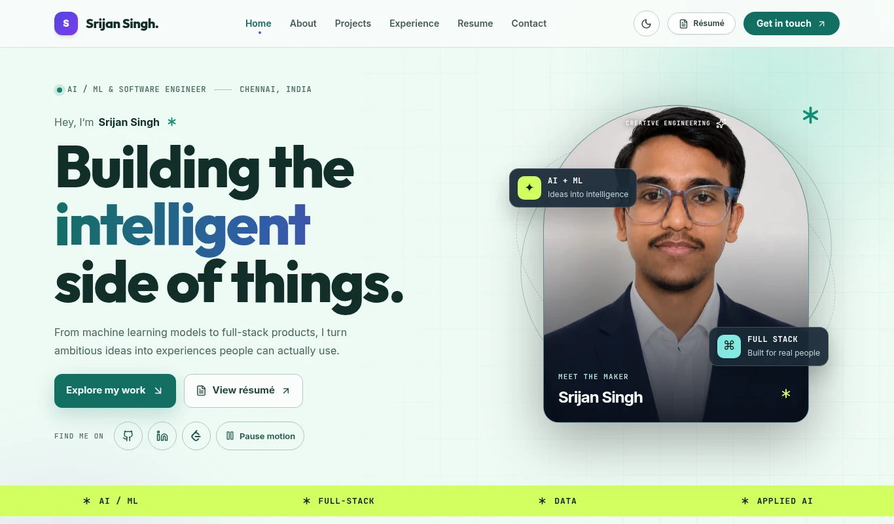

# Srijan Singh · AI/ML & Full-Stack Portfolio

I’m a computer science student at SRMIST building applied machine learning projects, AI workflows, and full-stack software.

[Visit the live portfolio](https://srijansingh2006.github.io/PERSONAL-PORFOLIO-WEBSITE/)



## Explore the portfolio

- Browse nine projects across AI/ML, full-stack engineering, and data and product work. Each case study explains the problem, approach, implementation, and results, and links to the source.
- Read about my experience and credentials, preview the résumé, or open the PDF.
- Switch between the mint light theme and the dark theme. The site remembers your preference.
- The introduction uses staggered headline and portrait entrances. Project cards move into their new positions when you change filters, and the artwork responds to hover and keyboard focus. Motion follows your device’s reduced-motion setting.

## Run locally

```bash
git clone https://github.com/SrijanSingh2006/PERSONAL-PORFOLIO-WEBSITE.git
cd PERSONAL-PORFOLIO-WEBSITE
npm ci
npm run dev
```

Open the URL printed by Vite. Run `npm run build` to build the production site in `dist/`.

## Stack and deployment

The site uses React, Vite, Tailwind CSS, Framer Motion, and Lucide icons. GitHub Actions builds the site and publishes it to GitHub Pages from the `gh-pages` branch. [Deployment workflow](./.github/workflows/deploy.yml)

## Connect

- [GitHub](https://github.com/SrijanSingh2006)
- [LinkedIn](https://www.linkedin.com/in/srijan-singh-999a552a9)
- [Email](mailto:srijansingh2006@gmail.com)
